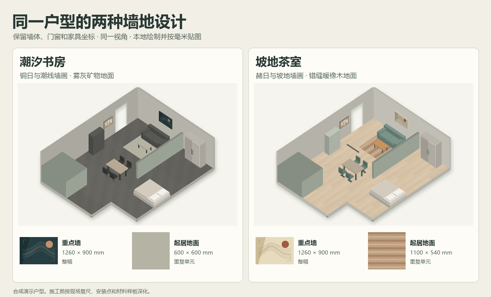

# 空间设计 Spatial Design

给一张平面图，说清谁用、要保留什么、最想改善什么。Skill 会整理设计方向，按确认过的几何生成平面、同坐标三维和逐件摆放资料。支持办公、住宅、零售及多建筑园区的空间方案。

上图是可复跑的合成住宅。潮汐书房采用铜日、等高线和灰色矿物地面。坡地茶室用赭日、田埂线条和错缝暖木。两套保持同一家具位置和视角，墙地纹样由本地绘图生成，按毫米贴到实际构件。

## 安装与试用

从 [Releases](https://github.com/wunianze666-netizen/opc-space-design/releases/latest) 下载 `spatial-design.zip`，把解压后的 `spatial-design` 整个目录放入 Agent 的 Skill 目录。旧版 `opc-space-design` 的 v1.0.0 文件仍可从对应历史版本获取。

| 宿主 | 项目内目录 |
| --- | --- |
| Codex | `.agents/skills/` |
| Claude Code | `.claude/skills/` |
| Gemini CLI | `.gemini/skills/` |
| Cursor | `.cursor/skills/` |

完整入口和能力差异见[宿主兼容说明](skill/spatial-design/references/portable-hosts.md)。在 Skill 目录用 Python 3.11 或以上安装 `requirements.txt`。中文出图需可用的中文字体。默认本地出图可在没有生图接口、模型密钥或 Blender 的环境运行。安装后可按[示例命令](skill/spatial-design/examples/tidal-room/README.md)复现上图。

> 用 $spatial-design 看这张图。我需要给 12 人做办公区，保留原门窗。来客经常看产品样品，员工要安静开会。请推荐一套，并给两种有区别的设计方向。交付整区三维、重点局部和逐件摆放表。

## 多建筑园区

[园区总平面示例](docs/campus-plan.png)和[建筑体量三维](docs/campus-volume.png)使用 8,000 m² 合成场地。可输入地块边界、建筑、入口、路径和功能区，输出同坐标 PNG、毫米 DXF 和入口连通检查。路径断开会显示待调整。室内单层几何计算范围是 2,500 m²、跨度 90 m、最多 200 个工位。多栋或多层需要逐层深化。[园区使用方法](skill/spatial-design/references/campus.md)

[三种园区设计对照](docs/campus-studies.png)覆盖科技展研、生态疗愈和社区学习。每组输入含 20 件带尺寸的设施，导出总图、逐件局部、坐标表、DXF 和同坐标三维。可记录长椅朝向、绿植范围、灯具、遮棚和由多个部件组成的定制装置。案例采用合成数据与相似的建筑道路组织，适用于复跑几何及出图流程。[园区设施设计方法](skill/spatial-design/references/campus-design.md)

## 怎样交付给委托方

- **只看结果**：从 Release 下载示例交付包。解压后打开《先看这里》和《整区总览.html》，浏览器可离线查看。转交项目时把整个交付文件夹压成 ZIP，便于打开三维、局部图和定位表。
- **继续用 Agent 设计**：发仓库链接和 Skill ZIP，附一句使用说明。项目图纸和客户资产放在双方约定的交付渠道。
- **照图摆放**：先确认总览的 A、B 和现场图纸方向，再按表量取。图纸缺关键尺寸时先出设计方向和补测项。涉及结构、机电、消防和固定安装时按项目现场复核。

[设计与出图流程](skill/spatial-design/SKILL.md) · [交付文件说明](skill/spatial-design/references/design-delivery.md) · [原创设计与本地绘图](skill/spatial-design/references/creative-direction.md)

## 验证范围

本项目在 Windows 的 Codex、Python 和 Chromium 中验证了办公、住宅、斜角零售及大面积办公的工作流。公开样例可用 `python examples/tidal-room/check_examples.py` 复测两套本地纹样、几何一致性、交付文件与越界输入。其他 Agent 的安装位置按各自公开文档提供，实际工具权限和出图效果需在相应客户端复核。纯聊天宿主可以整理概念和需求，几何校核与导出交给有脚本能力的环境。
